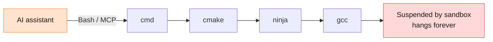
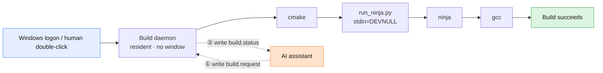
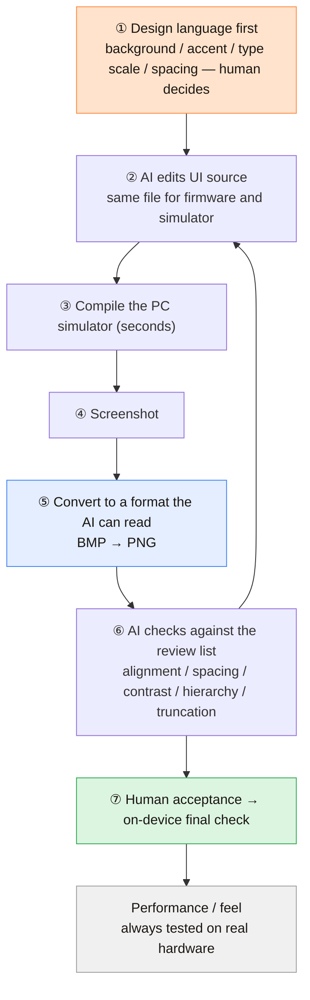
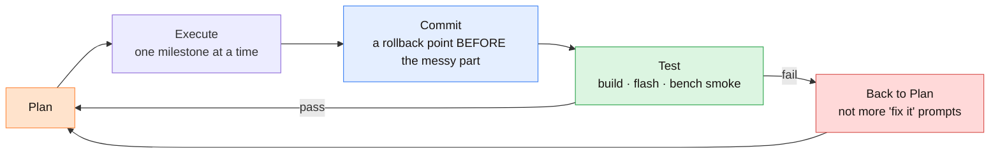
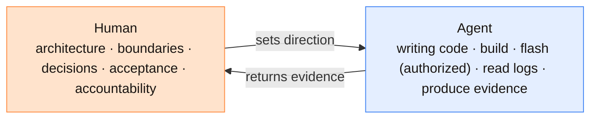

# Building ESP32 Firmware with an AI Agent: A Repeatable Engineering Path

[中文](./README.md) | **English**

> I built a real product firmware for ESP32-S3 from scratch on Windows, driven by an AI coding assistant (WorkBuddy).
> This is not an enthusiastic "AI wrote my code" post. It is the record of turning that into a **stable pipeline** —
> including the two fatal traps I hit, the 10 wrong hypotheses I disproved, and the six disciplines I ended up with.
>
> If you also drive embedded work with Cursor / Claude Code / Codex / WorkBuddy, this should save you a couple of days.


> The **full-length original article is in Chinese** ([`README.md`](./README.md)). This English version covers the same structure — all six stages, the pitfalls and the checklist — in a more compact form.

---

## Contents

- [0. Conclusions first](#0-conclusions-first)
- [1. Background](#1-background)
- [2. Prior art: how similar GitHub projects are written](#2-prior-art-how-similar-github-projects-are-written)
- [3. Stage 1 · Environment: pin every version](#3-stage-1--environment-pin-every-version)
- [4. Stage 2 · Build: your build must not descend from the AI assistant](#4-stage-2--build-your-build-must-not-descend-from-the-ai-assistant)
- [5. Stage 3 · Flash & verify: bench evidence is the only truth](#5-stage-3--flash--verify-bench-evidence-is-the-only-truth)
- [6. Stage 4 · UI: the screenshot loop](#6-stage-4--ui-the-screenshot-loop)
- [7. Stage 5 · Component reuse: license first, hidden dependency second](#7-stage-5--component-reuse-license-first-hidden-dependency-second)
- [8. Stage 6 · The contract with your agent](#8-stage-6--the-contract-with-your-agent)
- [9. Reusable checklist](#9-reusable-checklist)
- [10. Templates](#10-templates)
- [11. Known limitations](#11-known-limitations)
- [12. References](#12-references)

---

## 0. Conclusions first

1. **AI made writing code fast; it did not make "making it run" simple.** The bottleneck moved to environment, build, verification, and organization.
2. **Never let the AI assistant be an ancestor of the build process.** My build hung indefinitely because the assistant host's **child-process sandbox** suspends `gcc` when compilers are spawned rapidly. The only variable was *how the build was launched*.
3. **The first diagnostic for any "environment voodoo" is a launch-method A/B test.** This alone localizes most of it.
4. **If you see a thread in `Suspended` state, ask "who is the parent?" before suspecting antivirus.** That mistake cost me a full day.
5. **Move the build into a resident daemon; the agent only writes a request file and reads a status file.** It never spawns a process — zero lineage to the build.
6. **For any build inside a hidden-window background service, explicitly set the child's stdin to `DEVNULL`.** Otherwise `ldgen` dies silently with `errorcode -1`.
7. **Keep `cmd.exe` scripts 100% ASCII.** On zh-CN Windows they are parsed as GBK, and non-ASCII bytes get executed as commands.
8. **UI iteration must close the loop until the agent can *see* it**: edit → render → screenshot → the agent reviews it → repeat. No blind edits.
9. **Before reusing a component: check its license, then check for "hidden dependencies" its CMakeLists never declared.**
10. **Humans own architecture and acceptance; the agent owns typing.** Anything that ships wrong is the human's responsibility.

> **AI assistants make command-line automation effortless, but they introduce a new, invisible failure domain: the child-process control layer.
> When a "spawns lots of children" task like a build hangs for no reason, suspect process lineage, not antivirus.**

---

## 1. Background

To give the rest of this document a coordinate system:

**Product**: an ESP32-S3 voice study companion for high-school students.

| Item | Spec |
|---|---|
| SoC | ESP32-S3-R8 (8 MB PSRAM) + 16 MB flash |
| Display | 3.5" ST7796S, native 320×480 portrait (used as 480×320 landscape) |
| Touch | GT911 (I2C) |
| Audio | ES8311 codec + NS4150 amp + dual mics |
| Power | 1000 mAh battery, MP2636GR charger with charge-detect pin |
| Other | microSD slot, GC0308 / OV5640 camera (DVP) |

**Stack**: ESP-IDF v6.0.1 + LVGL + C/C++, target `esp32s3`.

**Key constraint**: this is a real product, not a demo — it must connect to Wi-Fi, run a captive portal for provisioning, render Chinese text, and stay stable on real hardware. That is exactly where AI-written code tends to break.

---

## 2. Prior art: how similar GitHub projects are written

Before writing anything, I went through the "AI + embedded" repositories on GitHub. They fall into three shapes, and each is written very differently:

### Shape A: tooling repos (for "I want to use this")

[`cmd0s/esp32-ai-loop-mcp-server`](https://github.com/cmd0s/esp32-ai-loop-mcp-server) — gives Claude Code a real ESP32 and closes the edit→build→flash→observe loop.

Its README is a great template:

```
One-line positioning
→ TL;DR: opens with a REAL dialogue (human asks, agent does, what came back)
→ Why this exists: pain stated plainly
→ Install: Path A (one command) / Path B (hand-written config)
→ Tool list as a table
→ Comparison table against adjacent tools
→ Caveats / known issues as its own section — limits openly owned
```

### Shape B: framework repos (for "I want to follow this method")

[`kamocat/esp-agentic-dev`](https://github.com/kamocat/esp-agentic-dev) — a development framework for agentic coding assistants.

Takeaway: it ships the agent's instruction file (`CLAUDE.md`) as a **deliverable** in `templates/` so people can copy it, draws the agentic cycle in 6 steps, and lists chip support as a matrix.

### Shape C: vendor/personal methodology essays (for "I want to understand this")

Highest signal — Espressif's official blog:

- [Developing a Rust-based IoT device with AI](https://developer.espressif.com/blog/2026/04/rust-coding-with-ai/)
- [Developing a Zephyr IoT app with AI](https://developer.espressif.com/blog/2026/06/zephyr-coding-with-ai/)

The author frames AI-assisted firmware work as a set of contract-like rules. My own conclusion, reached independently before reading these, matches almost line for line:

> - A written **spec** beats ad-hoc prompts
> - **Reference code** beats prose alone
> - **Git** is the undo key; milestones deserve commits
> - **Bounded tasks** beat "implement the subsystem"
> - **Traces and bench evidence** beat arguing from source
> - The human owns **architecture and evaluation**; the agent owns typing
> - **All issues are the human's** when something ships wrong

And the master loop they insist on: **Plan → Execute → Commit → Test**, with three hard rules — *one milestone per plan execution*, *on test failure go back to planning instead of stacking "fix it" prompts*, and ***keep a journal*** (otherwise the AI retries approaches that already failed).

> The line I agree with most: **"Code is cheap, judgment is not."**

### What I chose

**Shape C's skeleton + Shape A's pitfall list.**

Because in this domain the scarce asset is not code (the AI writes code) — it's the **record of traps and the discipline**. So:

```
Six stages (environment → build → flash → UI → component reuse → human/agent contract)
+ what actually happened in each stage
+ a checklist you can tick through
+ templates you can copy directly
```

---

## 3. Stage 1 · Environment: pin every version

**This is where AI most easily produces an environment that "looks right but doesn't run".**

| Component | Pinned version | Why |
|---|---|---|
| ESP-IDF | **v6.0.1**, source kept locally | Upstream component ecosystem already adapted; toolchain is version-locked to it |
| Toolchain | `xtensa-esp-elf` **15.2.0_20251204** | The version IDF v6.0.1 mandates. Installing 16.x triggers a picolibc `cookie_io_functions_t` type conflict and the build simply fails |
| CMake / Ninja | 4.0.3 / 1.12.1 | The versions IDF ships; don't use your system's |
| Python | IDF's own env (3.13) | Avoids package conflicts with the system Python |

On this machine I assembled the environment **manually** — under a network proxy the official installer could not fetch anything. Lesson: **freeze the environment into one script** so every build runs in the identical environment, and the agent never has to "understand" the environment — it only has to call that one script.

### Give your agent two kinds of tools: knowledge and action

Espressif's own framing, which I adopted:

| Kind | Purpose | Example |
|---|---|---|
| **Knowledge** | Let the AI read real docs instead of hallucinating APIs | ESP-IDF Documentation MCP Server |
| **Action** | Let the AI actually build, flash, and read serial | ESP-IDF Tools local MCP server (built into v6.0+) |

**Keep these separate.** Action without knowledge → code that doesn't compile. Knowledge without action → the AI pastes code at you and you become the build system.

> When the AI hallucinates an API, your first question should be **"does it have a documentation source?"**, not "it's dumb".

---

## 4. Stage 2 · Build: your build must not descend from the AI assistant

**This is the most valuable section in this document.** Full post-mortem: [`docs/01-build-hang-postmortem.md`](docs/01-build-hang-postmortem.md).

### 4.1 Symptom

The build stops halfway, no output, never exits:

```
[~700/1866] Completed 'bootloader'
(and then… nothing)
```

Happens almost every time the AI drives the build, unpredictably. Two days lost.

### 4.2 Localization: single-variable A/B test

```
1. Sample build/.ninja_log twice → mtime unchanged
2. Check gcc / cc1 CPU usage → ≈ 0
3. Check thread state → WaitReason = Suspended     ← suspended by an external party
```

Then run the **single-variable test** — same code, same machine, only the launch method changes:

| Launch method | Result |
|---|---|
| Via the AI assistant's tools (Bash / MCP build) | ❌ **Always hangs**: multiple `gcc` threads `WaitReason = Suspended` |
| **A human double-clicking an independent script** (outside the assistant's process tree) | ✅ **Full success**: `[1866/1866]`, `EXIT=0`, ~4 minutes |

**The only variable was the launch method. Root cause: the AI host's child-process sandbox.**

### 4.3 The 10 hypotheses I wasted time on

| # | Hypothesis | Verdict |
|---|---|---|
| 1 | Output pipe deadlock through Git-Bash | ✗ |
| 2 | Antivirus HIPS suspending the compiler | ✗ |
| 3 | A leftover third-party driver | ✗ |
| 4 | A security product's filter driver | ✗ |
| 5 | Concurrency race | ✗ |
| 6 | Out of memory | ✗ (62% used, no crash dump) |
| 7 | Disk / IO bottleneck | ✗ (zero IO delta while hung) |
| 8 | Long path / CJK characters in path | ✗ |
| 9 | Cloud-sync file locking | ✗ |
| 10 | Corrupted IDF component tree | ✗ (that's the **normal shape** of that version; the log line is **harmless**) |

> **Sunk-cost warning**: 8 of these 10 sound very plausible. Their only common feature is that
> **none of them explains "then why does it succeed when launched manually?"**
> **If a hypothesis can't explain why changing the launch method fixes it, it's wrong.**

### 4.4 The fix: a build daemon





The contract is pure file drop — so simple it needs no protocol:

| File | Semantics |
|---|---|
| `build.request` | Agent writes `full` or `inc` |
| `build.status` | Daemon writes `RUNNING …` / `DONE … exit=<rc>` |
| `build.log` | Full compiler output, `EXIT=<code>` at the end |
| `build-daemon.heartbeat` | Timestamp refreshed ~every 20 s (liveness) |
| `.daemon.lock` | `mkdir` atomic lock for single-instance |

All six files are in [`templates/daemon/`](templates/daemon/), with paths genericized.

> ⚠️ **Critical**: a **human** must launch the daemon once outside the sandbox (double-click the installer, or let the Startup folder do it at logon).
> If you start it from the assistant's background, it **inherits the sandbox** and the problem returns.

### 4.5 Trap #2: the hidden console inherited as stdin

After moving the build into the daemon, the hang disappeared — but a **deterministically reproducible** failure appeared:

```
[1861/1866] Generating esp-idf/esp_system/ld/sections.ld
FAILED: esp-idf/esp_system/ld/sections.ld
Batch file failed at line 3 with errorcode -1
```

The strange part: `ldgen` actually finished its work (`sections.ld`, 122 KB, was generated), then hung silently for ~55 s during exit and was killed with `-1` — **and no traceback**.

A/B result, same machine, same command, all inside the daemon:

| Invocation | Result |
|---|---|
| Running the `.bat` directly, with every stdio combination | ✅ rc=0 |
| `ninja -C build` via python with **`stdin=DEVNULL`** | ✅ **rc=0, full chain produces the `.bin`** |
| `ninja -C build` **launched directly by cmd** (inherits the hidden console's stdin) | ❌ **`ldgen` = -1** |

**The only decisive variable is ninja's stdin.** The daemon's console is hidden (window style `0`); when cmd launches ninja directly, ninja inherits that console as stdin and `ldgen` dies silently at exit.

The fix is a tiny wrapper ([`templates/daemon/run_ninja.py`](templates/daemon/run_ninja.py)):

```python
import subprocess, sys
args = ["ninja"] + sys.argv[1:]
rc = subprocess.run(args, stdin=subprocess.DEVNULL).returncode
sys.exit(rc)
```

> This is a **general trap**, not project-specific: **any hidden-window background service that runs a build can hit "the child inherited a stdin it should never have".**
> Fix: set stdin to `DEVNULL` / `NUL` explicitly. (Fallback: use "minimized" style `7` instead of fully hidden `0`.)

### 4.6 Two bonus script bugs

| Problem | Cause | Fix |
|---|---|---|
| Script exited instantly with `EXIT=2` | I wrote `idf.py build -j N` — **`idf.py` does not accept `-j`** | `idf.py reconfigure`, then drive ninja |
| Chinese comments broke the script | **`cmd.exe` parses scripts with the OEM codepage (GBK on zh-CN)**; non-ASCII bytes executed as commands | Keep **all comments/echo ASCII-only** |

### 4.7 Evidence, not "should be fine now"

```
STATUS : DONE ... exit=0
LOG    : [1866/1866] full build complete
Sandbox interceptions: 0     ← inside the sandbox it was 1 (fullclean blocked, 239 files left behind)
Duration: 4 min 44 s
Processes: zero Suspended throughout
```

---

## 5. Stage 3 · Flash & verify: bench evidence is the only truth

**Rule: flashing requires explicit authorization.** Report the **port and the absolute firmware path** and wait for confirmation. Flashing is the one action that changes physical state, and the board may be somewhere nobody can reach.

| Action | Who | Note |
|---|---|---|
| Enumerate ports / detect board | Agent | Read-only, safe |
| Build, generate merged image | Agent (via daemon) | Stage 2 |
| **Flash** | Agent, **after human authorization** | Report port + path, wait |
| **Look at the screen / feel the touch** | **Human** | The agent has no hands |
| Read serial logs | Agent | These are the agent's eyes |

### Give the agent assert-like logs, not narration

```
I (1234) dada_net: config AP ON: ssid='DaDa-A1B2' url=192.168.4.1
```

Print variable values (`ssid='...' url=...`), not "provisioning started". The former the agent can **verify**; the latter it can only repeat back to you.

### Provide a merged image and a one-click flash

During debugging, flashing 4 partitions by hand invites mistakes:

```bat
gen-merged.cmd     :: merge bootloader / partition-table / app into one bin
burn-merged.cmd    :: write it from 0x0 in one shot
```

Benefit: reproducing your problem on another machine needs **one file**.

---

## 6. Stage 4 · UI: the screenshot loop

Full detail: [`docs/02-ui-simulator-workflow.md`](docs/02-ui-simulator-workflow.md).

**Core principle: an AI must not "blind-edit" UI.** It has no visual intuition about the layout it wrote. It must **see**.

### One comparison image beats a thousand words

<table>
<tr>
<td width="50%" align="center"><br><sub><b>Early</b>: AI hand-written layout, font subsetting not done<br>→ a screen full of "tofu" boxes</sub></td>
<td width="50%" align="center"><br><sub><b>Later</b>: design language first + font subset + screenshot after every change<br>→ layout, hierarchy, Chinese all correct</sub></td>
</tr>
</table>

> Between these two images, **not one line of "the AI learned aesthetics"** happened.
> What changed was the process: aesthetics handed back to the human (design language first), the ability to *see* handed to the AI (screenshot self-check), and hard constraints like fonts handed to a script.

### The loop



**Prerequisite**: the simulator must compile the *same* UI source as the firmware, with a host layer replacing ESP-IDF / FreeRTOS / networking / power services. Otherwise "it's correct in the simulator" means nothing.

> Step ⑤ — the last-mile format conversion — is what makes or breaks the loop.
> "Small" steps like that are the dividing line between a working AI loop and "the AI thinks it's done".

**Be honest about the boundary** (put it in `AGENTS.md`, or the AI will "verify" performance in the simulator):

| Verifiable in simulator | Must be tested on device |
|---|---|
| Layout, alignment, spacing, colour, hierarchy | Touch feel, responsiveness |
| Text truncation / missing glyphs | Frame rate, memory, power |
| Interaction flow, state transitions | Audio, RF, peripheral timing |

### Chinese fonts are trap #1 on the device side

Built-in CJK fonts are unusable on MCUs (size and performance). You must **pre-generate a subset**:

```
scan Chinese string literals in source
  → filter against the TTF's cmap
  → lv_font_conv generates a C array
  → compiled into the firmware
```

**Rule: after changing any copy text, re-run the font script** — otherwise you get tofu boxes.


<sub>Font specimen: the same string across fonts. Note the boxes in the small text on the left — **that is a missing glyph, i.e. a character the subset doesn't cover.** Almost every Chinese-text problem on device can be localized with this image.</sub>

Two more subtle traps:

| Trap | Symptom | Handling |
|---|---|---|
| Subsets are built per character | `°` / `℃` missing from the text → box on screen | **Avoid such symbols** (write the word "degrees") rather than growing the font |
| CJK passed on the command line gets corrupted (GBK) | Conversion fails | Pass **hexadecimal codepoint ranges**, or run from a script file |

**Licensing**: use **open-source regular fonts** for the device. **Never ship brand/VI commercial fonts in firmware.**

---

## 7. Stage 5 · Component reuse: license first, hidden dependency second

Full detail: [`docs/03-component-reuse.md`](docs/03-component-reuse.md).

### Discipline 1: check the license before deciding to reuse or write

**The first step is not reading code, it's reading the license.** Three concepts to keep apart:

| Statement | Actual meaning |
|---|---|
| "It's open source" | You can **read** the code |
| "It's MIT" | You can **use** it (commercially, closed-source), with attribution |
| "Its whole-device firmware is not open" | You may copy the **idea** only, not the code |

> Most dangerous case: a device where **a sub-feature is open but the whole firmware is not**.
> Seeing a repo full of code and assuming you can copy the whole product is a disaster.

### Discipline 2: logic is copyable, UI is not

> **Reuse the logic layer; rebuild the presentation layer in your own brand language.**

Whether that's possible depends on the component's architecture. In `esp-wifi-connect`, the logic (SSID manager / STA / DNS server) and the presentation (embedded HTML pages, **55% of the code**) are cleanly separated — replacing those HTML files swaps the branding while logic stays untouched.

**Find that seam first.** If UI strings are scattered through the logic, writing it yourself is cleaner than reusing.

### Discipline 3: after vendoring, hunt for hidden dependencies

I vendored the component into `components/` and deleted `idf_component.yml` (for fully offline, reproducible builds). It broke immediately:

```
fatal error: cJSON.h: No such file or directory
```

**Cause**: upstream's `CMakeLists.txt` **never declared `cjson`** — it was injected by `idf_component.yml`. Deleting the yml broke the chain.

> **`idf_component.yml` is not documentation — it really performs dependency injection.**
> **The price of going offline is that you must supply whatever it used to inject.**

### Discipline 4: "the component wasn't compiled" is an illusion

Build passed but the binary barely grew — easy to conclude the component wasn't compiled in.

```
1. Does build/esp-idf/<component>/lib<name>.a exist, and how big?   ← it was already there
2. Does your application actually call it?                          ← the linker's dead-code elimination is the cause
```

Measured here: 825,264 B → **1,611,280 B (+786,016 B)** once actually called.

### Bonus: provisioning pitfalls (component-independent)

ESP32-S3 is **2.4 GHz only**, **no WPA2-Enterprise** (campus/enterprise networks won't work), hidden SSIDs aren't scanned; captive-portal detection URLs differ per platform and **HTTPS/DoH cannot be intercepted → you must tell users, in large text, to type `192.168.4.1`**; SoftAP is open by default → add a password; multi-device hot-spots need a MAC suffix.

> The one genuinely dangerous trap: **stored SSID + connection failure + `ESP.restart()` = infinite reboot, i.e. a brick.**
> **A physical reset entry point is the bottom line** (failure counter ≥ 3 → clear credentials → back to provisioning).

---

## 8. Stage 6 · The contract with your agent

**This is the dividing line between "works once" and "works for months".** The hard part is that session #20's AI still knows your rules.

### Master loop: Plan → Execute → Commit → Test



That is PDCA wearing firmware clothes. Stages 2 and 3 make the build **run**; this loop makes it **last**.

### `AGENTS.md`: the single entry point at repo root

Put an `AGENTS.md` at the repository root and require the AI to read it first. It should contain: what the repo is, directory conventions (which layer may touch hardware), pre-work discipline, **delivery format**, machine environment notes, and current status. Copy [`templates/AGENTS.md`](templates/AGENTS.md).

> **`AGENTS.md` is not a prompt for the AI; it's an institution for you.**
> It is the only thing that carries what you figured out today to the AI three months from now.

### Delivery format: four sections, no hiding

```
Build      : did it compile?
Host       : was it run in the PC simulator?
Device     : was it on real hardware, and what did you see?
Unverified : what is NOT verified yet        ← must not be vague
```

Its power is that it **closes the "pretend it's done" path**. LLMs are excellent at making you believe work is finished; forcing them to enumerate unverified items is the highest-value single defense.

### Institution: always leave a record

Three document types: **decision docs** (why this choice, what was rejected), **root cause docs** (engineer-facing detail), and **public post-mortems** (`postmortem-YYYY-MM-DD-*.md`: timeline + disproved hypotheses + checklist).

The third is the institution I established this time — **after any major incident, write a report readable by outsiders.** Writing for others forces you to close the loop; notes to yourself usually don't.

### Division of labour



> Best summary I've read: **working with an AI is a lot like managing a junior developer who types extremely fast and has no judgment.**

---

## 9. Reusable checklist

**Diagnosing "environment voodoo"**

- [ ] **Always start with a launch-method A/B test** (manual vs via the AI's tools).
- [ ] Seeing `Suspended`, ask **"who is the parent?"** first — not antivirus.
- [ ] Before accusing third-party software, demand **its own log evidence**.
- [ ] Drop any hypothesis that can't explain "why does changing the launch method fix it?".

**Designing an AI-driven build chain**

- [ ] **Make sure the build's ancestor is not the AI assistant** (daemon / scheduled task / service).
- [ ] The agent should only **drop files and poll status** — never spawn the build.
- [ ] In hidden-window background builds: **set the child's stdin to `DEVNULL` / `NUL`**.
- [ ] Prefer "minimized" (style `7`) over "fully hidden" (style `0`).
- [ ] The daemon must be launchable by a **human** once, outside the sandbox, and auto-start at logon.
- [ ] Express state as **files** (simple, observable, protocol-free).

**Windows + ESP-IDF**

- [ ] `cmd.exe` script comments: **ASCII only**.
- [ ] `idf.py` **does not accept `-j`**; use `idf.py reconfigure` then drive ninja.
- [ ] Toolchain version must **match** the IDF version exactly.
- [ ] Long tasks: **redirect to a file**, never pipe through `| tail` (buffering).
- [ ] Freeze environment variables into **one script**.

**Working with an AI**

- [ ] `AGENTS.md` at repo root; the AI reads it before acting.
- [ ] Four-section delivery; `Unverified` must be specific.
- [ ] UI changes **must** be screenshot-checked — no blind edits.
- [ ] Before reusing third-party code: **license → architectural separability → hidden dependencies.**
- [ ] After major incidents, write a **public post-mortem** and distill it into a checklist.
- [ ] One milestone per plan execution; on failure **go back to planning**.

---

## 10. Templates

| File | Usage |
|---|---|
| [`templates/AGENTS.md`](templates/AGENTS.md) | Copy to your repo root; swap the "what this repo is / directory conventions / environment notes" sections |
| [`templates/daemon/`](templates/daemon/) | The six daemon files. **Replace the placeholders at the top of each file**, then double-click `install-build-daemon.cmd` once |
| [`templates/mcp.example.json`](templates/mcp.example.json) | How to configure an MCP client (knowledge source and action source separately) |

```
One-time : double-click install-build-daemon.cmd   (resident from every logon afterwards)
Daily    : agent writes build.request = "inc" | "full"
           daemon builds → writes build.status
           agent polls build.status until DONE → reads build.log
```

---

## 11. Known limitations

1. **The sandbox phenomenon was verified on WorkBuddy + Windows 10.** Mechanically, any agent host that manages child processes could hit it, but **I only measured it there**.
2. **The daemon contract is file polling, not events.** ~2 s latency, in exchange for zero dependencies, zero protocol, and being debuggable at a glance.
3. **Windows always costs more than Linux** (drivers, codepages, process management). If you can, Linux is nicer for embedded work.
4. **This document does not address "quality of AI-generated code" as a philosophical question.** My position: the human is accountable; quality is enforced by `AGENTS.md`, four-section delivery, and on-device verification — not by hope.

---

## 12. References

- [`cmd0s/esp32-ai-loop-mcp-server`](https://github.com/cmd0s/esp32-ai-loop-mcp-server)
- [`kamocat/esp-agentic-dev`](https://github.com/kamocat/esp-agentic-dev)
- [Espressif · ESP-IDF Tools Local MCP Server](https://developer.espressif.com/blog/2026/04/esp-idf-tools-mcp-server)
- [Espressif · Developing a Rust-based IoT device with AI](https://developer.espressif.com/blog/2026/04/rust-coding-with-ai/)
- [Espressif · Developing a Zephyr IoT app with AI](https://developer.espressif.com/blog/2026/06/zephyr-coding-with-ai/)
- [`78/xiaozhi-esp32`](https://github.com/78/xiaozhi-esp32)

**License**: MIT (documentation). Keep the attribution when reusing.

**Contributing**: the most valuable part of this repo is the pitfall list. If you hit a trap not covered here,
open an issue or a PR — **this checklist is supposed to keep growing.**
