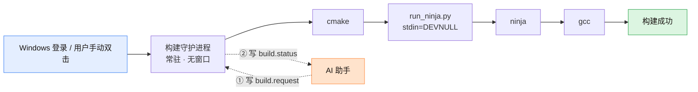
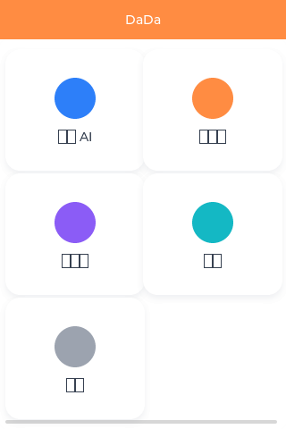
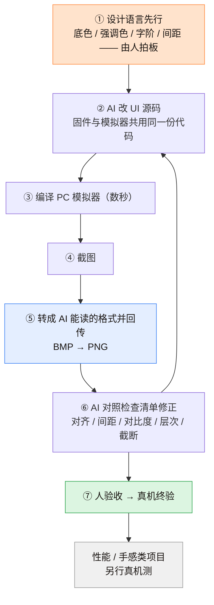
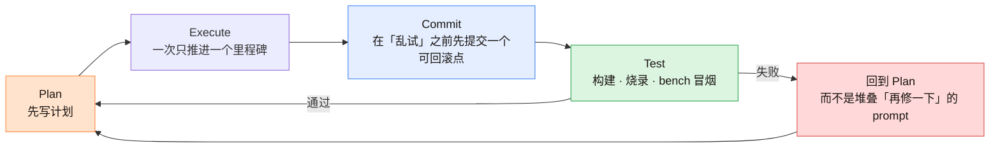

# 用 AI Agent 开发 ESP32 固件：一条可复制的工程路线

**中文** | [English](./README.en.md)

> 我在 Windows 上用 AI 编程助手（WorkBuddy）从零做了一个跑在 ESP32-S3 上的真实产品固件。
> 这篇文章不是「AI 帮我写代码」的兴奋分享，而是**把它跑成一条稳定流水线**的过程记录——
> 包括我踩过的两个致命坑、被推翻的 10 个错误假设，以及最后沉淀下来的六条纪律。
>
> 如果你也在用 Cursor / Claude Code / Codex / WorkBuddy 之类的助手做嵌入式，这篇能帮你少走两天。


---

## 目录

- [0. 先看结论](#0-先看结论)
- [1. 这个项目是什么（背景）](#1-这个项目是什么背景)
- [2. 先做功课：GitHub 上同类项目是怎么写的](#2-先做功课github-上同类项目是怎么写的)
- [3. 环节一 · 环境装配：把版本钉死](#3-环节一--环境装配把版本钉死)
- [4. 环节二 · 构建：让构建的祖先不是 AI 助手](#4-环节二--构建让构建的祖先不是-ai-助手)
- [5. 环节三 · 烧录与真机验证：一切以 bench evidence 为准](#5-环节三--烧录与真机验证一切以-bench-evidence-为准)
- [6. 环节四 · UI 迭代：模拟器截图闭环](#6-环节四--ui-迭代模拟器截图闭环)
- [7. 环节五 · 组件复用：先查许可证，再查隐藏依赖](#7-环节五--组件复用先查许可证再查隐藏依赖)
- [8. 环节六 · 与 Agent 的契约](#8-环节六--与-agent-的契约)
- [9. 可复用 Checklist](#9-可复用-checklist)
- [10. 附：本仓库模板怎么用](#10-附本仓库模板怎么用)
- [11. 已知局限](#11-已知局限)
- [12. 参考与致谢](#12-参考与致谢)

---

## 0. 先看结论

如果你只看一段，看这段：

1. **AI 让写代码变快了，但没有让"跑起来"变简单。** 真正的瓶颈从"写"转移到"环境、构建、验证、组织"。
2. **别让 AI 助手当构建进程的祖先。** 我遇到的构建无限期卡死，根因就是 Agent 宿主的**子进程管控层**在密集创建编译器进程时把 `gcc` 挂起。唯一变量是**启动方式**。
3. **排查"环境玄学"的第一步永远是"换一种启动方式对照实验"。** 这一步能直接定位大部分看似无解的问题。
4. **看到线程状态 `Suspended`，先问"父进程是谁"，不要先去怀疑杀毒软件。** 我为此浪费了整整一天。
5. **把构建搬进一个常驻守护进程，AI 只做「写请求文件 + 读状态文件」。** 全程不拉起任何进程，血缘上与构建无关。
6. **隐藏窗口的后台服务里跑构建，必须显式把子进程 stdin 设为 `DEVNULL`。** 否则 `ldgen` 会以 `errorcode -1` 静默死亡。
7. **`cmd.exe` 脚本里的注释/echo 只用 ASCII。** zh-CN 下用 GBK 解析，中文注释会被当成命令执行。
8. **UI 迭代必须闭环到"看得见"**：改代码 → 模拟器渲染 → 截图 → AI 自己看 → 再改。禁止盲改。
9. **复用别人的组件之前，先看许可证，再看它有没有"没写进 CMakeLists 的隐藏依赖"。**
10. **人负责架构与验收，Agent 负责打字。** 所有出问题的地方，责任都在人。

一句话总结：

> **AI 编程助手让"命令行自动化"变得极其方便，但它引入的「子进程管控层」是一个新的、看不见的故障域。
> 当构建、测试这类"重子进程"任务出现无法解释的挂起时，优先怀疑进程血缘，而不是杀毒软件。**

---

## 1. 这个项目是什么（背景）

为了让下文有具体的坐标系，先说清楚我在做什么。

**产品**：一台面向新高一学生的 ESP32-S3 语音学习伴设备（应用名「嗒嗒 DaDa」）。

**硬件**（网购的一块 3.5 寸带触摸的开发板 + 外壳）：

| 项 | 规格 |
|---|---|
| 主控 | ESP32-S3-R8（8 MB PSRAM）+ 16 MB Flash |
| 屏 | 3.5" ST7796S，原生 320×480 竖屏（逻辑用 480×320 横屏） |
| 触摸 | GT911（电容触摸，I2C） |
| 音频 | ES8311 编解码 + NS4150 功放 + 双麦 |
| 电源 | 1000 mAh 电池，MP2636GR 充电管理（带电检测脚） |
| 其他 | microSD 卡槽、GC0308/OV5640 摄像头（DVP） |

**技术栈**：ESP-IDF v6.0.1 + LVGL + C/C++，目标芯片 `esp32s3`。

**关键约束**：真实产品，不是 demo——要联网、要配网、要显示中文、要在真机上长时间稳定运行。这恰好是"AI 写的代码"最容易露馅的场景。

---

## 2. 先做功课：GitHub 上同类项目是怎么写的

动手写这篇之前，我先把 GitHub 上「AI + 嵌入式」这一类项目的写法扒了一遍。结论是它们基本分三种形态，**不同形态的写法完全不一样**：

### 形态 A：工具型仓库（写给"我要用这个工具"的人）

代表：[`cmd0s/esp32-ai-loop-mcp-server`](https://github.com/cmd0s/esp32-ai-loop-mcp-server)（给 AI 一个真实 ESP32，闭合 edit → build → flash → observe 循环）

它的 README 结构非常好抄：

```
一句话定位（Give Claude Code a real ESP32 on its desk）
→ TL;DR：用一段真实的「人对 AI 说话 → AI 干了什么」对话开场
→ Why this exists：把痛点讲透（AI 看不到设备输出，每次改动都是猜的）
→ Install：Path A（一条命令）/ Path B（手写配置文件）
→ 工具清单：表格，一列名称一列作用
→ 对比表：和相邻方案逐项对比（谁支持后台抓日志、谁支持自动让出串口）
→ Caveats / known issues：单列一节，主动承认限制
```

**可抄的点**：TL;DR 用真实对话而不是抽象描述；痛点单独成节；限制主动列出来。

### 形态 B：框架型仓库（写给"我要按这套方法来"的人）

代表：[`kamocat/esp-agentic-dev`](https://github.com/kamocat/esp-agentic-dev)（面向 agentic coding assistant 的 ESP32 开发框架）

**可抄的点**：把给 AI 的规范文件（`CLAUDE.md`）当作**交付物**放在 `templates/` 里让人直接拷；把「agentic 开发循环」画成 6 步；用表格列芯片支持矩阵；末尾写清贡献方向。

### 形态 C：厂商/个人方法论长文（写给"我要理解这件事"的人）

代表（含金量最高）：Espressif 官方博客的两篇——

- [Developing a Rust-based IoT device with AI](https://developer.espressif.com/blog/2026/04/rust-coding-with-ai/)
- [Developing a Zephyr IoT app with AI](https://developer.espressif.com/blog/2026/06/zephyr-coding-with-ai/)

作者 Ricardo F. Tafas Jr. 把「和 AI 一起做固件」总结成一套契约式规则，我这篇文章的骨架基本与它同构（我是先做完再读到它的，可见这套东西是被独立验证过的）：

> - 写下来的 **spec** 胜过临时 prompt
> - **参考代码**胜过纯文字描述
> - **Git** 是实验失败时的撤销键；里程碑值得提交
> - **有边界的任务**胜过"把整个子系统实现掉"
> - **trace 与 bench 证据**胜过对着源码辩论
> - 人负责**架构与验收**，Agent 负责打字
> - 出问题都是**人的责任**

以及它反复强调的主循环：**Plan → Execute → Commit → Test**，并且明确写了三条纪律：*一次计划只执行一个里程碑*、*测试失败要回到 planning 而不是堆叠"再修一下"的 prompt*、***journal 必须留***（否则 AI 会反复尝试它已经试过且无效的招）。

> 那句我最认同的话是：**"Code is cheap, judgment is not."**（代码是廉价的，判断力不是。）

### 我最后选择了什么写法

**形态 C 的骨架 + 形态 A 的坑清单。**

因为这条路线上真正稀缺的资产不是代码（代码 AI 会写），而是**踩坑记录和纪律**。所以我这篇的主体是：

```
六个环节（环境 → 构建 → 烧录 → UI → 组件复用 → 人机契约）
+ 每个环节里"真实发生过的事"
+ 一份可以逐条打勾的 Checklist
+ 一套可以直接拷走的模板（AGENTS.md / 守护进程 / MCP 配置）
```

本仓库文件组织（模仿上面几个仓库的习惯）：

```
.
├── README.md                          ← 你正在看的这篇（主文）
├── README.en.md                       ← English version
├── docs/
│   ├── 01-build-hang-postmortem.md    ← 构建僵死复盘（一手素材，最有价值）
│   ├── 02-ui-simulator-workflow.md    ← UI 模拟器截图闭环 + 中文字体管线
│   └── 03-component-reuse.md          ← 组件复用：许可证 / 离线化 / 隐藏依赖
├── templates/
│   ├── AGENTS.md                      ← 直接放到你工程根目录的 Agent 契约模板
│   ├── daemon/                        ← 构建守护进程六件套（路径已泛化）
│   └── mcp.example.json               ← MCP 配置示例
└── assets/                            ← 文中用到的截图
```

---

## 3. 环节一 · 环境装配：把版本钉死

**AI 最容易在这里制造"看起来对、其实跑不通"的环境。**

### 3.1 版本必须钉死，而且要有理由

| 组件 | 我钉的版本 | 为什么是它 |
|---|---|---|
| ESP-IDF | **v6.0.1**（源码留本地） | 上游组件生态已适配 v6；工具链版本与之强绑定 |
| 交叉工具链 | `xtensa-esp-elf` **15.2.0_20251204** | **v6.0.1 钦定版本**；误装 16.x 会触发 picolibc 的 `cookie_io_functions_t` 类型冲突，编译直接失败 |
| CMake / Ninja | 4.0.3 / 1.12.1 | IDF 自带版本，别用系统里那个 |
| Python | IDF 官方 env（3.13） | 避免和系统 Python 的包冲突 |

> 教训：**工具链版本必须与 IDF 版本严格匹配**。这类"编译报一堆莫名其妙的类型错"的问题，八成是版本漂移，不是代码问题。

### 3.2 一个反面案例：不要迷信一键安装器

我这台机器的环境最终是**手动装配**的：网络代理环境下，官方安装器（EIM）拉不下来东西。最后是自己设 `IDF_PATH` / `IDF_TOOLS_PATH` / `IDF_PYTHON_ENV_PATH` / `PATH` 拼出来的。

所以：**把环境变量固化进一个脚本**，让每次构建都是同一个环境。我的做法是集中在一个 `build-quiet.cmd` 里（见 [模板](templates/daemon/build-quiet.cmd)）：

```bat
set IDF_PATH=D:\Espressif\v6.0.1\esp-idf
set IDF_TOOLS_PATH=C:\Espressif
set ESP_IDF_VERSION=6.0.1
set IDF_PYTHON_ENV_PATH=C:\Espressif\python_env\idf6.0_py3.13_env
set PATH=C:\Espressif\tools\xtensa-esp-elf\esp-15.2.0_20251204\xtensa-esp-elf\bin;...;%PATH%
```

好处：AI 不需要"理解"环境，它只需要会调用这一个脚本。**把不确定性收敛到一个文件里。**

### 3.3 给 AI 的两类工具：知识 与 动作

Espressif 官方现在的定位很清楚（我认同并采用了这个划分）：

| 类型 | 作用 | 例子 |
|---|---|---|
| **知识** | 让 AI 读到真文档，而不是靠记忆编 API | ESP-IDF Documentation MCP Server |
| **动作** | 让 AI 真的能建、能烧、能看串口 | ESP-IDF Tools Local MCP Server（v6.0 内置）、串口/烧录工具 |

**这两件事必须分开。** 只有"动作"没有"知识"，AI 会写出编译不过的 API；只有"知识"没有"动作"，AI 只能给你贴代码让你复制粘贴。

> 经验：AI 出现"API 幻觉"时，**第一反应应该是"它有没有文档源"，而不是"它太笨了"**。

---

## 4. 环节二 · 构建：让构建的祖先不是 AI 助手

**这是整篇文章最值钱的一节。** 完整复盘见 [`docs/01-build-hang-postmortem.md`](docs/01-build-hang-postmortem.md)，这里给结论。

### 4.1 症状

构建跑到一半不动了，控制台没有任何输出，也不退出：

```
[~700/1866] Completed 'bootloader'
（然后……没有然后了）
```

只要让 AI 助手驱动构建，**几乎必然发生**，且无法预判。整整两天无法推进项目。

### 4.2 定位手法：唯一变量对照实验

```
1. 对 build/.ninja_log 间隔采样两次 → mtime 不变
2. 查 gcc / cc1 进程 CPU 占用 → ≈ 0
3. 查线程状态 → WaitReason = Suspended     ← 被外部显式挂起
```

然后做**唯一变量实验**——同样的代码、同样的机器，只换启动方式：

| 启动方式 | 结果 |
|---|---|
| 经 AI 助手工具调用（Bash / MCP 的 build） | ❌ **必卡**：多个 `gcc` 线程 `WaitReason = Suspended` |
| **人手动双击一个独立脚本**（脱离 AI 助手进程树） | ✅ **完整成功**：`[1866/1866]`、`EXIT=0`、约 4 分钟 |

**唯一变量是"启动方式"，根因定案：AI 宿主的子进程管控/沙箱。**

### 4.3 我浪费掉的 10 个假设（重点看这个）

这两天里我真实花时间验证过、最后**全部证伪**的方向：

| # | 假设 | 结论 |
|---|---|---|
| 1 | 输出经 Git-Bash 管道死锁 | ✗ |
| 2 | 杀毒软件 HIPS 挂起编译器 | ✗ |
| 3 | 某残留驱动 | ✗ |
| 4 | 某安全软件的过滤驱动 | ✗ |
| 5 | 并发竞态 | ✗ |
| 6 | 内存不足 | ✗（故障时仅用 62%，无崩溃转储） |
| 7 | 磁盘 / IO 瓶颈 | ✗（卡死时 I/O 增量 = 0） |
| 8 | 路径过长 / 含中文 | ✗ |
| 9 | 云盘同步锁文件 | ✗ |
| 10 | IDF 组件树损坏 | ✗（那是该版本**正常形态**，日志里那句是**无害提示**） |

> **沉没成本警告**：这 10 条里有 8 条是"看起来很有道理"的。它们唯一的共同点是——**都不能解释"为什么手动跑就成功"**。
> **如果一个假设不能解释"那为什么换一种启动方式就好了"，它就是错的。**

### 4.4 根治方案：构建守护进程




**契约是纯文件投递**（简单到不需要任何协议）：

| 文件 | 语义 |
|---|---|
| `build.request` | AI 写入：`full`（全量）或 `inc`（增量） |
| `build.status` | 守护进程写入：`RUNNING …` / `DONE … exit=<rc>` |
| `build.log` | 完整编译输出，末尾写 `EXIT=<code>` |
| `build-daemon.heartbeat` | 每约 20 秒刷新的时间戳（判断守护进程是否活着） |
| `.daemon.lock` | `mkdir` 原子锁，保证单实例 |

六件套全部在 [`templates/daemon/`](templates/daemon/)，路径已泛化，换个 `DIR` 就能用。

> ⚠️ **关键前提**：守护进程必须**由人在沙箱外启动一次**（双击安装器，或登录时由 explorer 自动拉起）。
> 如果从 AI 助手后台把它拉起来，它**仍然继承沙箱**，问题照旧。这一条是整个方案成立的基础。

### 4.5 第二坑：隐藏控制台被 ninja 继承为 stdin

把构建搬进守护进程后，卡死消失了，但冒出一个**确定性复现**的新失败：

```
[1861/1866] Generating esp-idf/esp_system/ld/sections.ld
FAILED: esp-idf/esp_system/ld/sections.ld
Batch file failed at line 3 with errorcode -1
```

诡异之处：`ldgen` 活其实干完了（`sections.ld` 已生成 122 KB），然后在**退出阶段静默挂约 55 秒**被杀成 `-1`，**没有任何 traceback**。

**对照实验**（同一台机器、同一条命令，全部在守护进程内）：

| 调用方式 | 结果 |
|---|---|
| 直接跑那个 `.bat` / 改 stdout、stderr、stdin 各种组合 | ✅ rc=0 |
| `ninja -C build`，**经 python 拉起且 `stdin=DEVNULL`** | ✅ **rc=0，整链成功** |
| `ninja -C build`，**由 cmd 直启**（继承隐藏控制台的 stdin） | ❌ **`ldgen` -1** |

**唯一的决定性变量是 `ninja` 的 stdin。** 守护进程的控制台是隐藏的（窗口样式 `0`），cmd 直启 ninja 时它把该控制台当 stdin 继承下去，`ldgen` 就在退出阶段静默死亡。

修法就是一个小 wrapper（[`templates/daemon/run_ninja.py`](templates/daemon/run_ninja.py)）：

```python
import subprocess, sys
args = ["ninja"] + sys.argv[1:]
rc = subprocess.run(args, stdin=subprocess.DEVNULL).returncode
sys.exit(rc)
```

> 这是个**通用陷阱**，不限于本项目：**任何"隐藏窗口的后台服务/守护进程"里跑需要子进程的构建，都可能踩到"子进程继承了不该继承的 stdin"。**
> 规避方式：显式把 stdin 设为 `DEVNULL` / `NUL`。（另一个兜底：用"最小化"窗口样式 `7` 而不是完全隐藏 `0`。）

### 4.6 附带修掉的两个脚本 Bug

| 问题 | 原因 | 修复 |
|---|---|---|
| 构建脚本秒退 `EXIT=2` | 我写了 `idf.py build -j N`，但 **`idf.py` 不支持 `-j`** | 改为 `idf.py reconfigure` + 交给 ninja 驱动 |
| 中文注释导致脚本报错 | **`cmd.exe` 用 OEM 代码页（zh-CN = GBK）解析脚本**，非 ASCII 字节被误当命令执行 | 脚本内**所有注释/echo 强制 ASCII-only** |

### 4.7 证据（别信"应该好了"）

```
STATUS : DONE ... exit=0
LOG    : [1866/1866] 全量构建完成
沙箱拦截: 0 次            ← 对比沙箱内那次：1 次（fullclean 被拦，遗留 239 个文件）
耗时   : 4 分 44 秒
进程   : 全程零 Suspended
产物   : bootloader + partition-table + app 三件齐全
```

---

## 5. 环节三 · 烧录与真机验证：一切以 bench evidence 为准

**规则：烧录必须显式授权。** 执行前必须先报出 **串口 + 固件绝对路径**，等人确认。

这条不是形式主义。烧录是唯一一个"会改变物理世界状态"的动作，而且设备可能正插在别人够不到的地方。

### 5.1 让 AI 能自己做的那部分

| 动作 | 谁做 | 说明 |
|---|---|---|
| 枚举串口 / 探测板子 | AI | 只读，安全 |
| 编译、生成合并固件 | AI（经守护进程触发） | 见环节二 |
| **烧录** | **人授权后 AI 执行** | 报出端口与路径，等确认 |
| **上电后看画面 / 触摸手感** | **人** | AI 没有手 |
| 读串口日志 | AI | 这是 AI 的眼睛 |

### 5.2 AI 的眼睛 = 串口日志

AI 看不到屏幕，所以**串口输出是唯一的真值来源**。我的做法是让关键状态都打明确的日志：

```
I (1234) dada_net: config AP ON: ssid='DaDa-A1B2' url=192.168.4.1
```

有这行日志，AI 就能确认"联网栈起来了、配网热点开了"，不需要猜。

> **给 AI 的日志要写成"断言"而不是"叙述"**：把变量值打到日志里（`ssid='...' url=...`），
> 而不是打印"配网已启动"。前者 AI 能验证，后者只能复述。

### 5.3 合并固件与一键烧录

调试阶段每次都烧 4 个分区很容易出错，所以固化两步：

```bat
gen-merged.cmd     :: 把 bootloader / partition-table / app 合成一个 bin（-o 用绝对路径）
burn-merged.cmd    :: 从 0x0 一次写进去
```

好处：**换一台机器、或者让别人复现你的问题时，只需要一个文件。**

---

## 6. 环节四 · UI 迭代：模拟器截图闭环

详见 [`docs/02-ui-simulator-workflow.md`](docs/02-ui-simulator-workflow.md)。

**核心原则：AI 不能"盲改 UI"。** 它对自己写的布局没有视觉直觉，必须让它**看见**。

### 6.0 一张对照图，胜过一千字

<table>
<tr>
<td width="50%" align="center"><br><sub><b>早期</b>：AI 手写布局 + 字体未做子集<br>→ 整屏「豆腐块」，配色和层次全靠占位圆</sub></td>
<td width="50%" align="center"><br><sub><b>之后</b>：设计语言先行 + 字体子集 + 每次改完截图自检<br>→ 布局、层次、中文全部正常</sub></td>
</tr>
</table>

> 这两张图之间，**没有一行"AI 学会了审美"**。
> 改变的是流程：把审美决定权交还给人（设计语言先行），把"看见"的能力交给 AI（截图自检），把字体这类硬约束交给脚本。

### 6.1 闭环



关键设计：**模拟器编译的是与固件完全相同的那一份 UI 源码**，host 层顶替掉 ESP-IDF / FreeRTOS / 网络 / 电源服务。这样"模拟器里对了"才有意义。

> 技术细节：模拟器输出 BMP，但多模态模型读不了 BMP → 加一步 `bmp2png.py` 转 PNG 再回传。
> **这类"最后一公里"的转换脚本，是 AI 闭环能不能成立的关键。**

### 6.2 边界必须诚实

| 模拟器能验 | 模拟器不能验（必须真机） |
|---|---|
| 布局、对齐、间距、配色、层次 | 触摸手感、跟手度 |
| 文字是否截断 / 缺字形 | 帧率、内存、功耗 |
| 交互流程是否正确 | 音频、射频、外设时序 |

我调研的设备厂商 SDK 官方对模拟器的承诺也只有两条：**快速做 UI + 重复截图**。不夸大、不越界——**这个边界声明本身就该写进文档**，否则 AI 会在模拟器里"验证"性能。

### 6.3 中文字体是设备端的头号坑

内置 CJK 字库在嵌入式上基本不可用（体积/性能双爆），必须**预转子集**：

```
扫描源码里的中文字面量 → 按 TTF cmap 过滤 → lv_font_conv 生成 C 数组
```

**规则**：改文案后**必须重跑字体脚本**，否则界面出"豆腐块"。


<sub>字体样张：同一段中文在不同字体下的渲染。注意左侧小字里的方块——**这就是"缺字形"，是子集没覆盖到的字符**。设备端的中文问题几乎都能用这张图定位。</sub>

> 附带一个隐蔽的坑：子集是按字符生成的，所以文案里有没有 `°` `℃` 这种符号，决定了它能不能显示。
> 我最后是**避开这些符号**（用"度"字），而不是扩大字库。

---

## 7. 环节五 · 组件复用：先查许可证，再查隐藏依赖

详见 [`docs/03-component-reuse.md`](docs/03-component-reuse.md)。

### 7.1 纪律一：先看许可证，再决定抄还是写

我要做配网（Wi-Fi 配网 + 城市选择）。有两条路：复用一个成熟组件，或自己写。

**动手前先做了一件事：查许可证。**

| 对象 | 许可证 | 能否二创/商用/闭源 |
|---|---|---|
| 小智 AI 固件 | MIT | ✅ |
| `78/esp-wifi-connect` 组件 | MIT | ✅ |
| 同类设备固件 | MIT | ✅ |
| 某商业整机固件 | **未开源** | ❌ 只能参考思路，无代码可抄 |

**结论**：全 MIT，可以二创商用闭源，只需附一份 `THIRD_PARTY_NOTICES.md` 保留版权声明。

> 这一步花 20 分钟，能避免将来整个产品重写。**"它开源了"和"我能用它的代码"是两件事。**

### 7.2 纪律二：逻辑可以抄，UI 不能抄

我的原则（也是我建议所有人的原则）：

> **逻辑层可以复用，展示层必须回到自己的 VI 语言。**

好在很多组件的架构天然支持这个切分：以 `esp-wifi-connect` 为例，它的**逻辑层**（SSID 管理 / STA 连接 / DNS 服务器）与**展示层**（内嵌的 HTML 页面，占代码量 55%）是分离的——只需要替换两个 HTML 文件就能换成自己的品牌页面，逻辑一行不用碰。

**先找组件里的这条缝，再决定要不要自己写。** 如果逻辑和 UI 糊在一起，自己写反而更干净。

### 7.3 纪律三：vendor 之后，一定要查隐藏依赖

我把组件 vendor 进 `components/` 并删掉 `idf_component.yml`（为了完全离线、可复现）。删完立刻出问题：

```
fatal error: cJSON.h: No such file or directory
```

**原因**：上游的 `CMakeLists.txt` 里**根本没有声明 `cjson` 依赖**——它是靠 `idf_component.yml` 自动注入的。我把 yml 删了，依赖链就断了。

**修法**：在组件的 `CMakeLists.txt` 上手动补 `cjson` 到 `REQUIRES`。

> **通用教训**：`idf_component.yml` 不只是"声明依赖给你看"，它**真的在做依赖注入**。
> **离线化的代价 = 你必须自己补上它注入过的东西。**

### 7.4 纪律四：组件"没被编译"是幻觉

接入组件后构建通过、产物却几乎没变大，很容易得出"组件根本没被编译进去"的错误结论。

**实际检查方法**：

```
1. 看 build/esp-idf/<component>/lib<name>.a 是否存在、多大   ← 它早就在了
2. 看应用代码有没有真的调用它                                ← 链接器的死代码消除才是原因
```

我这次的实测：`libesp-wifi-connect.a` 2.34 MB、`libdada_net.a` 292 KB 都正常生成，只是因为当时上层还没调用，链接器没拉进去。真正接入调用后，产物从 **825 KB → 1,611 KB（+786 KB）**。

---

## 8. 环节六 · 与 Agent 的契约

**这是"能不能长期用下去"的分水岭。** 单次对话谁都会，难的是让第 20 次会话的 AI 还知道你的规矩。

### 8.0 主循环：Plan → Execute → Commit → Test



> 这其实就是 PDCA（Plan-Do-Check-Act）穿上了固件的衣服。
> 前两个环节（构建守护进程 / 烧录验证）解决的是"**跑得通**"，
> 这个循环解决的是"**跑得久**"——**没有它，AI 越快，代码债积得越快。**

### 8.1 `AGENTS.md`：放在仓库根目录的"唯一入口"

我采用（并推荐）业内已经在用的做法：仓库根放一个 `AGENTS.md`，**AI 动手前必须先读完它**。里面应该包含：

| 该写什么 | 例子 |
|---|---|
| 这个仓库是什么 | 一句话定位 + 三条不可动摇的边界 |
| 目录约定 | 哪层可以碰硬件、哪层绝对不许 |
| 开工前纪律 | 删代码前先查引用；烧录需授权；闭环三问 |
| **交付格式** | 见 8.2 |
| 本机环境备忘 | 版本、路径、镜像、已知的坑 |
| 当前状态 | 已完成 / 进行中 / 阻塞 |

可以直接用 [`templates/AGENTS.md`](templates/AGENTS.md) 改。

> 一句话经验：**`AGENTS.md` 不是写给 AI 的 Prompt，是写给你自己的制度。** 你今天想清楚的事，是这个项目唯一能传给"三个月后的 AI"的东西。

### 8.2 交付格式：四段式，不许隐瞒

任何功能交付，必须按四段报告：

```
Build      ：编译是否通过
Host       ：是否跑过 PC 模拟器
Device     ：是否上过真机、看到了什么
Unverified ：哪些部分还没验证        ← 不许留空含糊
```

这套格式的威力在于**它把"假装完成"这条路堵死了**。AI 非常擅长用流畅的语言让你以为事情做完了；强制它显式列出"未验证项"，是性价比最高的一条防线。

### 8.3 制度：遇事必留档

我把文档分成三类，各有用途：

| 类型 | 命名 | 作用 |
|---|---|---|
| **决策文档** | `*-decision-YYYY-MM-DD.md` | 为什么这么选，当时排除了什么 |
| **技术根因** | `*-rootcause.md` | 给工程师看的细节 |
| **对外复盘** | `postmortem-YYYY-MM-DD-*.md` | 时间线 + 误判清单 + Checklist，可对外分享 |

第三类是我这次新立的制度——**重大故障结案后，写一份"对外可读"的复盘报告**。理由很简单：写给自己看的技术笔记往往不完整，而"要给别人看"会强迫你把逻辑闭环。

本文的 [`docs/01-build-hang-postmortem.md`](docs/01-build-hang-postmortem.md) 就是这套制度的产物，也是我建议每个人照抄的东西。

### 8.4 人机分工


> 我听过最好的一句总结（来自上面那篇 Espressif 文章）：**和 AI 一起工作，非常像在带一个打字极快但没有判断力的初级工程师。**

---

## 9. 可复用 Checklist

### 排查"环境玄学"类问题

- [ ] **第一步永远是"换一种启动方式"对照实验**（手动跑 vs 经 AI 工具跑）。这一条能直接定位大部分问题。
- [ ] 看到线程 `Suspended`，先问"**父进程是谁**"，不要先怀疑杀软。
- [ ] 指控第三方软件之前，必须有**它自己的日志证据**。
- [ ] 如果一个假设解释不了"为什么换种方式就好了"，就放弃它。

### 设计 AI 驱动的构建链

- [ ] **让构建的祖先进程不是 AI 助手**（守护进程 / 计划任务 / 独立服务）。
- [ ] AI 侧只做**文件投递 + 状态轮询**，不要让它拉起构建进程。
- [ ] 后台/隐藏窗口里跑构建：**显式把子进程 stdin 设为 `DEVNULL`/`NUL`**。
- [ ] 优先用"最小化"（样式 `7`）而不是"完全隐藏"（样式 `0`）。
- [ ] 守护进程要能被**人**在沙箱外启动一次，并具备开机自启。
- [ ] 状态用**文件**表达（简单、可观测、不依赖协议）。

### Windows + ESP-IDF 的常规坑

- [ ] `cmd.exe` 脚本注释**只用 ASCII**。
- [ ] `idf.py` **不支持 `-j`**；要控并发先 `idf.py reconfigure` 再驱动 ninja。
- [ ] 工具链版本与 IDF 版本**严格匹配**。
- [ ] 长任务输出**重定向到文件**，不要经管道 `| tail`（会缓冲到天荒地老）。
- [ ] 环境变量固化进**一个脚本**，不要散落在文档里。

### 与 AI 协作

- [ ] 仓库根放 `AGENTS.md`，AI 先读再动手。
- [ ] 交付**四段式**，`Unverified` 不许含糊。
- [ ] UI 改动**必须截图自检**，禁止盲改。
- [ ] 复用第三方代码前：**查许可证 → 查架构可分性 → 查隐藏依赖**。
- [ ] 重大故障结案后写**对外复盘**，并沉淀成 Checklist。
- [ ] 一次计划只推动一个里程碑；测试失败**回到规划**，不要堆叠"再修一下"。

---

## 10. 附：本仓库模板怎么用

| 文件 | 用法 |
|---|---|
| [`templates/AGENTS.md`](templates/AGENTS.md) | 拷到你工程根目录，把「这个仓库是什么 / 目录约定 / 环境备忘」三节换成你自己的 |
| [`templates/daemon/`](templates/daemon/) | 构建守护进程六件套。**只需要改每个文件顶部的占位符**，然后双击 `install-build-daemon.cmd` 一次 |
| [`templates/mcp.example.json`](templates/mcp.example.json) | MCP 客户端配置的写法示例（知识源 + 动作源分开配） |

守护进程使用流程：

```
一次性：双击 install-build-daemon.cmd          （此后每次开机自动在场）
日常  ：AI 写 build.request = "inc" 或 "full"
        守护进程构建 → 写 build.status
        AI 轮询 build.status 到 DONE → 读 build.log
```

---

## 11. 已知局限

诚实部分（我认为开源项目必须有这一节）：

1. **沙箱现象的验证环境是 WorkBuddy + Windows 10。** 机制上任何对子进程做管控的 Agent 宿主都可能中招，但我**只在 WorkBuddy 上实测过**。如果你在别的宿主上复现了，欢迎补充。
2. **守护进程的契约是"轮询文件"，不是事件驱动。** 有约 2 秒延迟，换来的是零依赖、零协议、崩了也能一眼看懂。
3. **Windows 上必然比 Linux 多一层麻烦**（驱动、代码页、进程管理）。如果条件允许，Linux 主机做嵌入式开发确实更省心。
4. **本文不涉及"AI 生成的代码质量"这一命题**。我的观点很明确：质量责任在人，靠 `AGENTS.md`、四段式交付和真机验证来兜底，不靠祈祷。

---

## 12. 参考与致谢

**同类项目 / 文章**（都是我实际读过并从中取法的）：

- [`cmd0s/esp32-ai-loop-mcp-server`](https://github.com/cmd0s/esp32-ai-loop-mcp-server) —— 给 AI 一个真实设备，闭合 edit→build→flash→observe 循环
- [`kamocat/esp-agentic-dev`](https://github.com/kamocat/esp-agentic-dev) —— 面向 agentic assistant 的 ESP32 开发框架
- [Espressif · ESP-IDF Tools Local MCP Server](https://developer.espressif.com/blog/2026/04/esp-idf-tools-mcp-server) —— 官方把构建/烧录做成 MCP 动作
- [Espressif · Developing a Rust-based IoT device with AI](https://developer.espressif.com/blog/2026/04/rust-coding-with-ai/)
- [Espressif · Developing a Zephyr IoT app with AI](https://developer.espressif.com/blog/2026/06/zephyr-coding-with-ai/) —— 「契约 + Plan→Execute→Commit→Test」这套方法论讲得最清楚的一篇
- [`78/xiaozhi-esp32`](https://github.com/78/xiaozhi-esp32) —— MIT，我复用了它的语音管道思路与网络组件

**本文档许可**：MIT（文档部分）。转载/使用请保留出处。

**参与贡献**：这个仓库最有价值的部分是"坑清单"。如果你用 AI 做嵌入式踩到了本文没覆盖的坑，
欢迎按 [CONTRIBUTING.md](CONTRIBUTING.md) 提 Issue 或 PR——**这份 Checklist 应该越来越长才对。**

**Related readings**：For an English version of this article, see [`README.en.md`](README.en.md).

---

*如果你也在用 AI 做嵌入式，踩到了本文没覆盖的坑，欢迎开 Issue 补充——这份 Checklist 应该越来越长才对。*
