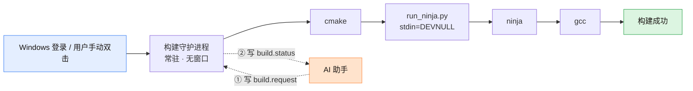
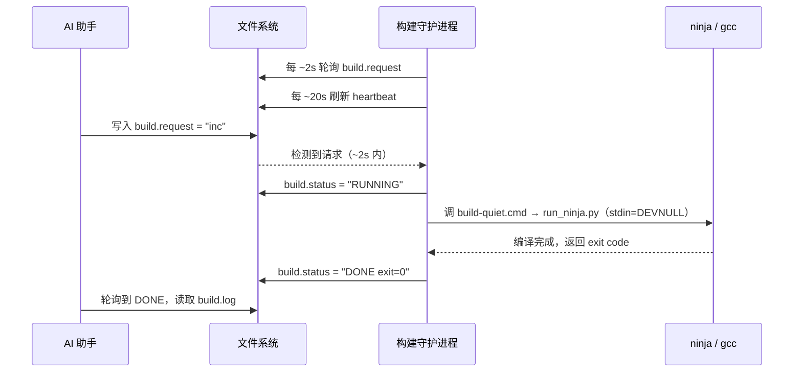

# 复盘报告：在 Windows 上用 AI 编程助手构建 ESP-IDF 项目，为什么总是"卡死"

> **事件**：构建僵死（无限期挂起），累计排查耗时约 **2 天**
> **发生时间**：2026-10-15 ~ 2026-10-16
> **结案时间**：2026-10-16 19:03（全量构建端到端验证通过）
> **适用环境**：Windows 10 19045 / ESP-IDF v6.0.1 / 经 AI 编程助手（WorkBuddy）驱动
>
> 本文是主文 [「用 AI Agent 开发 ESP32 固件」](../README.md) 第 4 节的完整一手复盘。
> 文中 `<PROJECT>` 指你的 ESP-IDF 工程根目录；可直接复用的模板见 [`../templates/daemon/`](../templates/daemon/)。

---

## TL;DR（三句话版）

1. **卡死的根因不是杀毒软件、不是硬件、不是并发数**——是 **AI 编程助手在启动子进程时的沙箱**，它在密集创建编译进程（`gcc`）的那一瞬间把进程**挂起**了。
2. 把构建**搬到一个与 AI 助手毫无血缘关系的常驻进程**里，卡死立刻消失；随后又暴露出第二个坑：**隐藏控制台被 `ninja` 当作 stdin 继承，会让 `ldgen` 步骤静默死亡（`errorcode -1`）**。
3. 两坑修完后，全量构建 `[1866/1866] EXIT=0`，**零干预、零卡死**、耗时 4 分 44 秒。

**如果你也在用 AI 助手（Cursor / Claude Code / Codex / WorkBuddy…）做嵌入式开发，请先看第 9 节的 Checklist。**

---

## 一、症状与判定

**现象**：构建进行到一半突然不动了，控制台没有任何输出，也不退出。日志永久停在：

```
[~700/1866] Completed 'bootloader'
（然后……没有然后了）
```

**判定僵死的方法**（可复用）：

```
1. 对 build/.ninja_log 间隔采样 2 次 → mtime 不变
2. 查 gcc / cc1 进程 CPU 占用 → ≈ 0
3. 查线程状态 → WaitReason = Suspended
```

**影响**：只要用 AI 助手驱动构建，**几乎必然发生**，且无法预判。开发循环被反复打断，两天无法推进项目。

---

## 二、环境快照

| 项 | 值 |
|---|---|
| 操作系统 | Windows 10 build 19045 |
| CPU / 内存 | i5-9400F / 16 GB |
| ESP-IDF | v6.0.1（`D:\Espressif\v6.0.1\esp-idf`，tag v6.0.1, commit `8c19b156`） |
| 工具链 | `xtensa-esp-elf` **15.2.0_20251204**（v6.0.1 钉死版本） |
| 构建系统 | CMake 4.0.3 + Ninja 1.12.1 |
| Python | IDF 官方 env（3.13） |
| 工程 | `<PROJECT>` = `C:\Users\Administrator\Desktop\ESP32\dada-launcher` |
| AI 助手 | WorkBuddy（经 Bash / MCP 工具驱动构建） |
| 安全软件 | 火绒（Huorong）——**事后证明完全无关** |

---

## 三、真根因（两条，按发现顺序）

### 根因 A：AI 助手的子进程沙箱会挂起编译器

**一句话**：凡是**从 AI 助手的工具树里生出来的进程**，都会经过一层子进程管控/沙箱；在构建这种"短时间内创建成百上千个子进程"的场景下，`gcc` 被挂起。

**决定性判定实验（唯一变量 = 启动方式）**：

| 启动方式 | 结果 |
|---|---|
| 经 AI 助手工具（Bash `cmd /c build-quiet.cmd`、MCP `build_project`） | ❌ **必卡**：多个 `gcc` 线程 `WaitReason = Suspended` |
| **用户手动双击 `run-build.cmd`**（脱离 AI 助手进程树） | ✅ **完整成功**：`[1866/1866]`、`EXIT=0`、约 4 分钟、零崩溃 |

> ⚠️ 注意：`WaitReason = Suspended` 表示线程**被外部显式挂起**——
> 它**既可能是杀软注入，也可能是父环境（沙箱）所为**。这一步极易误判（见第五节）。

**加强证据（沙箱的影响面比"挂起"更广）**：另行从 AI 助手后台上拉起构建时，抓到了三条铁证：

1. `build.log` 出现 `[safe-delete][SAFE_DELETE_BULK_CONFIRM_REQUIRED] {"count":244,"threshold":50,...}`
   → `idf.py fullclean` 想删的 244 个文件被**批量删除保护**拦下（实测遗留 239 个未删）。
2. `tools/cmake/component.cmake:258` 抛 `FATAL_ERROR`，而 **`${error}` 是空的**
   → 组件管理子进程**被静默掐死**（连 stderr 都没写出来），不是正常报错退出。
3. 同一次运行里 `build/` 目录被写入了新的 `CMakeCache.txt`，却停在半清理态。

**结论**：只要父进程是 AI 助手，构建就**不可能稳定**。必须彻底脱离进程树。

---

### 根因 B：隐藏控制台被 `ninja` 继承为 stdin，`ldgen` 静默死亡

把构建搬进守护进程后，**卡死消失了**（一路跑到 1862/1866），但冒出**新的、确定性复现**的失败：

```
[1861/1866] Generating esp-idf/esp_system/ld/sections.ld
FAILED: esp-idf/esp_system/ld/sections.ld
CMakeFiles\sections.ld-<hash>.bat <hash>
Batch file failed at line 3 with errorcode -1
```

那个 `.bat` 第 3 行执行的是 `python ldgen.py --config ... --objdump <objdump.exe>`（约 4660 字符），
末尾挂着 `|| (set FAIL_LINE=3& goto :ABORT)`。

**诡异之处**：`ldgen` 会打印几条 `Kconfig` NOTE，**活其实干完了**（`sections.ld` 已生成 122,024 字节），
然后在**退出阶段静默挂约 55 秒**，最后被杀成 `-1`——**没有任何 traceback**。这使它极难定位。

**排查手法（强烈推荐）**：不改守护进程，只在它调用的 `build-quiet.cmd` 里**临时插一个诊断分支**
（`if /i "%~1"=="diag" ...`）——因为守护进程**每次接单都会重新读取该脚本**。
这样就能在**真实故障环境**里跑对照实验，用完删掉分支即可。

**对照实验结果**（同一台机器、同一条命令，全部在守护进程内）：

| 调用方式 | 结果 |
|---|---|
| `cmd /c <ldgen 命令>`，继承 stdio | ✅ rc=0（约 18s） |
| `cmd /c <ldgen 命令>`，stdout/stderr 落文件 | ✅ rc=0 |
| `cmd /c <ldgen 命令>`，stdin=NUL | ✅ rc=0 |
| `cmd /c <ldgen 命令>`，stdout/stderr 走管道 | ✅ rc=0 |
| 直接 CreateProcess 跑 `.bat` | ✅ rc=0 |
| **`ninja -C build`（经 python 拉起，`stdin=DEVNULL`）** | ✅ **rc=0，整链成功产出 `.bin`** |
| **`ninja -C build`（由 cmd 直启，继承隐藏控制台的 stdin）** | ❌ **`ldgen` -1** |

**结论**：命令本身、Python、`objdump`、火绒**全部无辜**。唯一决定性变量是 **`ninja` 的 stdin**——
守护进程的控制台是**隐藏**的（`WScript.Shell.Run` 窗口样式 `0`），
cmd 直启 `ninja` 时 `ninja` 把该控制台当 stdin 继承下去，`ldgen` 就在退出阶段静默死亡。

> 这是一个**通用陷阱**，不限于本项目：**任何"隐藏窗口的后台服务/守护进程"里跑需要子进程的构建，
> 都可能踩到"子进程继承了不该继承的 stdin"**。规避方式：显式把 stdin 设为 `DEVNULL`/`NUL`。

---

## 四、时间线（两天）

| 时间 | 事件 |
|---|---|
| 10-15 | 反复遇到构建卡死，开始排查；一度怀疑管道死锁（把输出从 Git-Bash 管道改为直写文件） |
| 10-15 ~ 10-16 上午 | 怀疑安全软件。配置火绒信任区、查 `fltmc filters`（`sysdiag`/`exhlpdrv`/`ClawFlt`/`ahflt`）、直读火绒日志库、关闭恶意行为监控、禁用 2345 残留驱动、卸载微软电脑管家驱动、降并发 —— **全部无效** |
| 10-16 16:44 | **转折点**：用户手动双击 `run-build.cmd` → 构建**完整成功**（`[1866/1866]`、`EXIT=0`）。唯一变量是"启动方式"，定案：**根因 = AI 助手子进程沙箱** |
| 10-16 18:18 ~ 18:25 | 落地「构建守护进程」五件套 + 开机自启；从 AI 后台上拉起验证 → 机制正常但仍在沙箱内，抓到批量删除拦截 + 子进程被静默掐死的铁证 |
| 10-16 18:40 | 用户在**沙箱外**双击安装器启动守护进程；投递 `full` → 秒接单。**卡死彻底消失**（跑到 1862/1866，零 Suspended、零沙箱拦截） |
| 10-16 18:45 ~ 19:00 | 定位根因 B（隐藏控制台 stdin / `ldgen` -1），用插桩分支做六条件对照实验定案；新增 `tools/run_ninja.py` 修复 |
| 10-16 19:03 | **全量构建 `[1866/1866] EXIT=0`**，4 分 44 秒，三件产物齐全。结案 |

---

## 五、被推翻的错误假设（沉没成本清单，留档避免重蹈）

这些是本轮排查中**真实花掉时间**、最终**全部证伪**的方向。列出来，是为了让后来者少走：

| # | 假设 | 证伪方式 | 结论 |
|---|---|---|---|
| 1 | 输出经 Git-Bash 管道死锁 | 改为直写文件后，同样场景下用户手动跑**却成功** | ✗ |
| 2 | 火绒 HIPS 在进程创建时挂起编译器 | 火绒日志库 `log.db`→`HrLogV3_60` 直读，**无一条**涉及 `gcc`/`cc1`/`ninja`；关闭"恶意行为监控"后照样卡 | ✗ |
| 3 | 2345 残留驱动 `exhlpdrv` | 禁用 + 重启后照样卡 | ✗ |
| 4 | 微软电脑管家驱动 `ClawFlt` / `ahflt` | `fltmc unload` 成功后照样卡 | ✗ |
| 5 | 并发竞态 | 降到 3 并发照样卡 | ✗ |
| 6 | 内存不足 | 故障时仅用 62%（可用 6.2 GB），无 `WerFault` | ✗ |
| 7 | 磁盘 / IO 瓶颈 | 卡死时 I/O 增量 = 0 | ✗ |
| 8 | 路径过长 / 含空格中文 | `LongPathsEnabled=1`；全英文无空格 | ✗ |
| 9 | OneDrive / 云同步锁文件 | 进程未运行、桌面未重定向 | ✗ |
| 10 | IDF 组件树损坏（`components/mqtt/` 缺 `CMakeLists.txt`） | `git status` 干净、HEAD=`8c19b156`；该组件已迁出主仓，**这是 v6.0.1 的正常形态**，日志里那句是**无害提示** | ✗ |

**现场特征**（供日后对照）：

```
cc1                      PID=xxxxx  CPU≈0  thread[Wait/Suspended]      ← 被外部挂起
xtensa-esp32s3-elf-gcc   PID=xxxxx  CPU≈0  thread[Wait/Suspended]      ← 被外部挂起
ninja                    PID=xxxxx  CPU正常  thread[Wait/EventPairLow]  ← 正常等子进程
```

> 采集技巧：火绒数据库是**明文 SQLite**（`C:\ProgramData\Huorong\Sysdiag\`），原文件受保护，
> 把 `db` + `-wal` + `-shm` **一起复制副本**后即可直读。

---

## 六、解决方案

### 6.1 架构：把构建搬出 AI 助手的进程树




**守护进程文件清单**（全部位于 `<PROJECT>`）：

| 文件 | 作用 |
|---|---|
| `build-daemon.cmd` | 常驻守护进程：每 ~2s 轮询 `build.request`，收到即 `call build-quiet.cmd`，结果写 `build.status` |
| `build-daemon-hidden.vbs` | 以隐藏窗口拉起守护进程 |
| `build-daemon-autostart.vbs` | 开机自启垫片（清残锁 + 拉起） |
| `install-build-daemon.cmd` | 一次性安装器（停旧实例 → 清锁 → 装自启 → 立即启动） |
| `build-quiet.cmd` | 实际构建脚本（设好 IDF 环境变量 → reconfigure → 经 `run_ninja.py` 跑 ninja） |
| `tools/run_ninja.py` | **关键**：以 `stdin=DEVNULL` 拉起 ninja，规避根因 B |
| `run-build.cmd` | 回退入口：双击 = 立即跑一次全量构建（不依赖守护进程） |

### 6.2 契约：AI 侧怎么驱动（纯文件投递）

```
触发：向 build.request 写入一行     →  full（fullclean + 全量） 或 inc（增量）
结果：build.status                  →  RUNNING …  /  DONE … exit=<rc>
日志：build.log                     →  编译输出，末尾写 EXIT=<code>
存活：build-daemon.heartbeat        →  每 ~20s 刷新时间戳
互斥：.daemon.lock                  →  mkdir 原子锁保证单实例
```



> **关键**：AI 全程只碰文件系统，**从不拉起任何进程**。这就是"血缘隔离"的实现方式。

### 6.3 安装（一次性）

```
双击 <PROJECT>\install-build-daemon.cmd
```

之后**每次开机自动在场**，AI 直接投递请求即可，用户**无需再点任何东西**。

> ⚠️ 关键：这一步必须**由用户在沙箱外**完成（双击，或登录时 explorer 自动拉起）。
> 若从 AI 助手后台拉起守护进程，它**仍然继承沙箱**，问题照旧。

---

## 七、最终验证（硬数据）

```
STATUS : DONE 2026/10/16 19:03:37  exit=0
LOG    : [1866/1866] 全量构建完成
沙箱拦截: 0 次          ← 对比沙箱内那次是 1 次（fullclean 被拦，遗留 239 文件）
耗时   : 4 分 44 秒
进程   : 全程零 Suspended

产物：
  build/dada-launcher.bin                 825,264 B   （分区空闲 80%）
  build/bootloader/bootloader.bin          21,056 B
  build/partition_table/partition-table.bin 3,072 B
```

---

## 八、附带修复的两个脚本 Bug

| 问题 | 原因 | 修复 |
|---|---|---|
| `build-quiet.cmd` 秒退 `EXIT=2` | 原写 `idf.py build -j N`，而 **`idf.py` 不支持 `-j`**（报 `No such option: -j`） | 改为 `idf.py reconfigure` + 交给 `run_ninja.py` 驱动 ninja |
| `build-quiet.cmd` 中文注释致报错 | **`cmd.exe` 用 OEM 代码页（zh-CN = GBK）解析脚本**，非 ASCII 字节会被误当命令执行 | 脚本内**所有注释/echo 强制 ASCII-only** |

---

## 九、可复用 Checklist（给同样在用 AI 助手做嵌入式的你）

**排查优先级（按此顺序，能省下大量时间）**

- [ ] **第一步永远是"启动方式对照实验"**：同样的代码、同样的环境，换一种启动方式（手动双击 vs AI 工具调用）跑一遍。**这一条能直接定位 80% 的"环境玄学"问题。**
- [ ] 看到 `WaitReason = Suspended`，**不要立刻归因杀软**——先问"父进程是谁"。
- [ ] 把责任锁定到第三方软件之前，必须有**它自己的日志证据**（如火绒 `log.db`），而不是"它装了/它加载了驱动"。

**设计 AI 驱动的构建链时**

- [ ] **让构建的祖先进程不是 AI 助手**——守护进程 / 计划任务 / 独立服务均可。
- [ ] AI 侧只做**文件投递 + 状态轮询**，不要让它拉起构建进程（最干净）。
- [ ] 后台/隐藏窗口进程里跑构建：**显式把子进程 stdin 设为 `DEVNULL`/`NUL`**。
- [ ] 优先用"最小化"而非"完全隐藏"的窗口（样式 `7` 而非 `0`），可进一步降低 stdin/stdio 继承类问题。

**Windows + IDF 的常规坑**

- [ ] `cmd.exe` 脚本注释**只用 ASCII**（GBK 解析会吃掉非 ASCII）。
- [ ] `idf.py` **不支持 `-j`**；要控并发请 `idf.py reconfigure` 后直接驱动 ninja。
- [ ] 工具链版本必须与 IDF 版本严格匹配（v6.0.1 钉死 `xtensa-esp-elf 15.2.0_20251204`；误装 16.x 会触发 picolibc 类型冲突）。
- [ ] `components/mqtt/` 只有 `test_apps` 是 **v6.0.1 的正常形态**，日志提示**无害**，别追这条线索。
- [ ] 僵死判定 SOP：`ninja_log` mtime 两次采样不变 + `gcc` CPU≈0 → 杀进程 → `fullclean` → 换启动方式重跑。

---

## 十、一句话总结

> **AI 编程助手让"命令行自动化"变得极其方便，但它引入的"子进程管控层"是一个新的、看不见的故障域。**
> 当构建、测试这类"重子进程"任务出现无法解释的挂起时，**优先怀疑进程血缘，而不是杀毒软件。**

---

*相关：可直接复用的守护进程模板见 [`../templates/daemon/`](../templates/daemon/)；主文其余五个环节见 [`../README.md`](../README.md)。*
