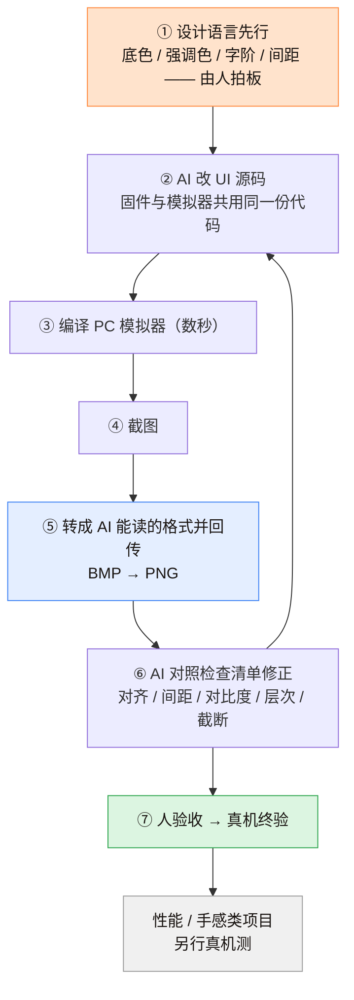
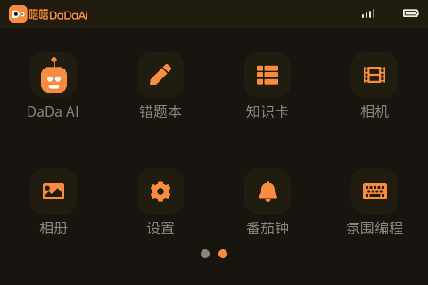

# UI 迭代：让 AI「看见」自己写的东西

> 主文第 6 节的展开。回答一个问题：**AI 没有眼睛，怎么让它做设备 UI 而不翻车？**

---

## 一、先调研：业界的三种流派

动手之前我把「AI + 嵌入式 UI」的现有做法扒了一遍，归纳成三条：

| 流派 | 代表 | 工作方式 | 适合 |
|---|---|---|---|
| **A. 模拟器截图闭环** | 某开源硬件 SDK 官方（SDL 无头模拟器） | AI 写 UI 代码 → SDL 模拟器渲染 → 截图回传 AI 自查 → 改 → 人做最终验收 | UI 迭代为主、真机只做终验 |
| **B. 真机截图闭环** | 各类「固件内置截图 API + OTA 上传」方案 | AI 烧录 → 拉真机 BMP → 看图 → 改 | 有屏真机在手、跳过模拟器 |
| **C. 可视化拖拽编辑器** | 浏览器内 WebAssembly 版 LVGL | 人拖拽设计 → 导出标准 C 代码 → AI 集成 | 设计驱动、要求代码可控性低 |

**我们选 A：模拟器截图闭环。** 理由是它迭代最快（编译数秒）、且不占用真机。

**选 A 的前提条件（很重要）**：

> 模拟器编译的必须是**与固件完全相同的那一份 UI 源码**，由 host 层顶替 ESP-IDF / FreeRTOS / 网络 / 电源服务。
> 否则「模拟器里对了」毫无意义。

---

## 二、闭环六步



> **第 ⑤ 步是整个闭环能否成立的关键。**
> 「最后一步格式转换」这种小事，就是 AI 闭环和「AI 以为自己做到了」之间的分界线。

**强制规则**：改 UI **必须**截图自检，**禁止盲改**。

理由来自一次真实翻车：我让 AI 手写布局，它自认为「很美观」，实际截图出来的效果惨不忍睹。AI 对布局没有视觉直觉——**它必须看见才能判断**。

### 闭环的产物长什么样

<table>
<tr>
<td width="50%" align="center"><br><sub><b>「看不见」阶段</b><br>AI 手写布局 · 字体未做子集<br>→ 整屏豆腐块，层次靠占位圆凑</sub></td>
<td width="50%" align="center"><br><sub><b>闭环之后</b><br>设计语言先行 · 字体子集 · 逐次截图自检<br>→ 底/字/色/层次全部落位</sub></td>
</tr>
<tr>
<td colspan="2" align="center"><br><sub>同一份源码在模拟器里渲染的另一页——AI 每次改动都靠这张图自查</sub></td>
</tr>
</table>

**注意这两张图之间没有发生的事**：AI 并没有"学会审美"。
改变的只是流程——**审美决定权交还给人，看见的能力交给 AI，硬约束（字体）交给脚本。**


---

## 三、边界必须诚实（写进文档）

| 模拟器能验 | 模拟器不能验（必须真机） |
|---|---|
| 布局、对齐、间距、配色、层次 | 触摸手感、跟手度 |
| 文字是否截断 / 缺字形 | 帧率、内存占用、功耗 |
| 交互流程、状态切换 | 音频、射频、外设时序 |

我调研的硬件 SDK 官方对模拟器的承诺也只有两条：**快速做 UI + 重复截图**。

**建议把这张表写进 `AGENTS.md`**——否则 AI 会在模拟器里"验证"性能，然后向你报告一切正常。

---

## 四、中文字体：设备端的头号坑

### 4.1 为什么不能直接用现成字库

- 内置 CJK 字库在嵌入式上体积巨大；
- TinyTTF 之类「运行时渲染大字体」的方案，每帧可能卡数秒，完全不可用。

### 4.2 正确做法：预转子集

```
扫描源码中的中文字面量
  → 按 TTF 的 cmap 过滤（只取真实存在的字符）
  → lv_font_conv 生成 C 数组
  → 编译进固件
```

**规则**：**改文案后必须重跑字体脚本**，否则界面出方块。

### 4.3 五层检查（每次动字体都跑）

1. **字符清单**：列出本次界面实际用到的所有字符（含数学/理化符号）
2. **子集化命令进版本库**（保证可复现）
3. **显式选中 + fallback 链**：字体必须显式指定，并有兜底
4. **覆盖测试（含负例）**：不仅测该出现的字，还要**故意给一个清单外的字**看是否崩/方块
5. **真机逐页肉眼验收**

### 4.4 两个隐蔽的坑

| 坑 | 现象 | 对策 |
|---|---|---|
| 子集是按字符生成的 | 文案里没有 `°` / `℃`，界面就显示方块 | **避开这些符号**（用「度」字），而不是无脑扩大字库 |
| 命令行传中文被编码损坏 | zh-CN 下 GBK 编码破坏参数 | 字符集一律传**十六进制码点 range**，或写成脚本文件执行 |

### 4.5 许可问题

设备端字体一律用**开源常规字体**（如思源黑体 / 阿里巴巴普惠体）。
**品牌 VI 里的商业字体不上设备**——避免固件分发时的授权风险。

> 一句话：**VI 字体是给物料用的，不是给固件用的。** 这两件事要分开。

---

## 五、给 AI 的提示词模板（借鉴自同类开源工程）

我调研的开源硬件 SDK 给 Agent 的提示词模板，结构非常适合照抄，大意是：

```
请基于完整项目 <仓库地址> 开发；本地已有项目则复用。
先读 AGENTS.md 和 docs/README.md，按需查阅相关文档、硬件接口及示例，
自行准备环境并安装项目要求的依赖。
保留已有修改，新建分支开发。复用 BSP，重新设计应用界面，不照搬 demo；
中文界面检查字体覆盖。关键需求不明确时询问，其余自主完成。
运行项目验证，交付可从 0x0 刷写的合并固件，说明测试结果与未验证项。
完成后主动询问是否刷机测试，未经确认不烧录。
```

**值得抄的四点**：

1. **先读文档再动手**（`AGENTS.md` 是入口）
2. **不照搬 demo**（避免 AI 直接复制示例，风格失控）
3. **中文界面必须检查字体覆盖**（这条对中文项目是刚需）
4. **未经确认不烧录** + **说明未验证项**（把风险交回给人）

---

## 六、一句话总结

> **AI 写 UI 的问题不是"写不出来"，而是"它不知道自己写得难看"。**
> 你的任务不是教它审美，而是给它一条**能看见自己作品的回路**——以及一条明确的边界，告诉它哪些东西在模拟器里永远测不出来。
